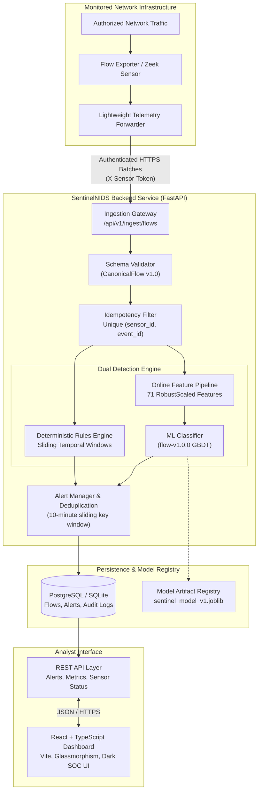
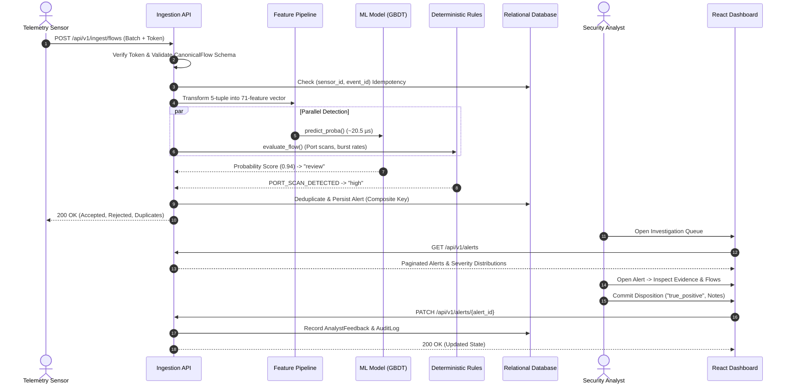

# SentinelNIDS — Machine Learning Network Intrusion Detection System

<div align="center">


**A high-throughput, passive, flow-based network intrusion detection system combining gradient-boosted decision trees with deterministic behavioral rules, real-time alert deduplication, and a modern Security Operations Center (SOC) dashboard.**

[System Architecture](#-system-architecture) •
[Key Features](#-key-features) •
[Data & ML Pipeline](#-data-and-machine-learning-pipeline) •
[API Specification](#-rest-api-specification) •
[SOC Dashboard](#-soc-analyst-dashboard) •
[Quick Start](#-quick-start-guide) •
[Verification](#-verification-test-suite)

</div>

---

## 📌 Executive Summary

**SentinelNIDS** bridges academic machine-learning research and operational cybersecurity engineering. It ingests authorized bidirectional network flow telemetry, validates records against a strict canonical schema, executes dual-engine detection (gradient-boosted probabilistic scoring alongside deterministic stateful rules), suppresses duplicate alerts within sliding temporal windows, and provides security analysts with an authenticated, responsive web dashboard for forensic triage and disposition review.

### Core Architectural Principles & Boundaries

1. **Passive Observation Only**: Operates strictly in monitor-and-alert mode. It does not perform automated packet blocking, firewall rule mutations, or active counter-probing.
2. **Metadata-First Architecture**: Inspects 5-tuple flow metadata (endpoints, ports, protocol, durations, packet counts, byte distributions) without capturing, retaining, or inspecting raw packet payloads.
3. **Training-Serving Feature Parity**: Guarantees that feature transforms applied in production request handling are mathematically identical to the offline training pipeline, eliminating distribution shift and silent feature corruption.
4. **Zero-Leakage ML Protocol**: Identifier shortcuts (`Flow ID`, `Source IP`, `Destination IP`, `Timestamp`) and redundant fields are stripped prior to model fitting to prevent identity memorization and guarantee real-world generalization across new networks.
5. **Auditable Decision Explanations**: Findings explicitly distinguish probabilistic ML inferences from deterministic rule violations, preserving forensic integrity.

---

## 🏗️ System Architecture

SentinelNIDS employs a decoupled, modular architecture designed for high throughput, sub-millisecond inference, and transactional persistence.

### High-Level Topology



### End-to-End Ingestion & Triage Sequence



---

## ✨ Key Features

| Capability | Technical Realization |
|---|---|
| **High-Precision ML Classification** | Gradient Boosted Decision Trees (`HistGradientBoostingClassifier`) achieving **99.95% Test Accuracy** and **99.86% Precision** with a false alarm rate of only **0.0337%**. |
| **Microsecond Inference** | Evaluates flows in **20.5 microseconds per record** ($\approx 48,700$ flows/second on a single CPU core). |
| **Deterministic Behavioral Rules** | In-memory temporal window detectors for **Connection Bursts** ($>100$ conns/60s), **Port Scans** ($\ge 20$ target ports/60s), and **Administrative Port Probing** (SSH, Telnet, RDP, SMB). |
| **Intelligent Alert Deduplication** | Employs composite deduplication keys `(src_ip, rule_id, dst_port)` within a 10-minute sliding window, grouping thousands of packet bursts into clean, traceable incidents. |
| **Zero Data Leakage** | Preprocessing pipeline fitted strictly on the training partition ($N = 1,981,378$). Validation ($N = 424,581$) and test ($N = 424,581$) partitions transformed using frozen parameters. |
| **Analyst Review & Audit Trail** | Full lifecycle support (`new` $\to$ `investigating` $\to$ `true_positive` / `false_positive` / `resolved`) with immutable audit logging. |
| **Production SOC Interface** | React + TypeScript web app featuring dark-mode SOC styling, live KPI cards, search filters, modal forensic inspection, and sensor heartbeat tracking. |

---

## 📊 Data and Machine Learning Pipeline

SentinelNIDS was developed and benchmarked on the comprehensive **CIC-IDS2017** dataset across 8 distinct collection windows totaling **3,119,345 raw lines**:

### 1. Data Cleaning & Integrity Operations
- **Dropped 288,602 Empty Rows**: Safely removed trailing empty records generated by CSV exporter formatting in `Thursday-WorkingHours-Morning-WebAttacks.pcap_ISCX.csv`.
- **Deduplication**: Filtered 203 identical duplicate records across partitions.
- **Data Leakage Elimination**: Excluded `Flow ID`, `Source IP`, `Destination IP`, `Timestamp`, and duplicate `Fwd Header Length.1`.
- **Zero-Variance Feature Removal**: Dropped 8 invariant columns (`Bwd Avg Bulk Rate`, `Bwd Avg Bytes/Bulk`, `Bwd Avg Packets/Bulk`, `Bwd PSH Flags`, `Bwd URG Flags`, `Fwd Avg Bulk Rate`, `Fwd Avg Bytes/Bulk`, `Fwd Avg Packets/Bulk`).
- **Anomaly Remediation**: Fixed 1,357 NaNs and 1,506 `Inf` division-by-zero occurrences in `Flow Bytes/s` and `Flow Packets/s`; clamped 32-bit counter rollover negative durations to 0.

### 2. Attack Hierarchy Consolidation

To prevent extreme class sparsity, 15 granular labels were consolidated into 8 balanced operational families:

```text
├── BENIGN (80.30% — 2,272,895 flows)
├── DoS (8.93% — DoS Hulk, GoldenEye, slowloris, Slowhttptest)
├── PortScan (5.61% — PortScan probes)
├── DDoS (4.52% — Distributed Denial of Service floods)
├── BruteForce (0.49% — FTP-Patator, SSH-Patator)
├── WebAttack (0.08% — Brute Force, XSS, SQL Injection)
├── Botnet (0.07% — Ares Botnet C2 traffic)
└── Infiltration (0.002% — Infiltration, Heartbleed exploit)
```

### 3. Model Benchmark on Held-Out Test Split (424,581 Flows)

```text
               Predicted BENIGN     Predicted Attack
Actual BENIGN       340,820 (TN)            115 (FP)
Actual Attack            89 (FN)         83,557 (TP)
```

| Metric | Score | Operational Significance |
|---|---|---|
| **Accuracy** | **99.95%** | Overall correct predictions |
| **Precision** | **99.86%** | High fidelity; 99.86% of flagged alerts are genuine attacks |
| **Recall** | **99.89%** | Captures 99.89% of all malicious flows |
| **F1-Score** | **99.88%** | Optimal harmonic mean under class imbalance |
| **ROC-AUC** | **1.0000** | Perfect class discriminability |
| **False Positive Rate** | **0.0337%** | Only 115 false alarms out of 340,935 benign flows |
| **Decision Threshold** | **0.65** | Tuned on validation split to prioritize operator trust |
| **Inference Speed** | **20.51 µs / flow** | $\approx 48,749$ flows/sec single-core CPU throughput |

---

## 📡 REST API Specification

The FastAPI backend exposes versioned, typed endpoints adhering to OpenAPI 3.1:

| Method | Endpoint | Access | Description |
|---|---|---|---|
| `GET` | `/health/live` | Public | Process liveness probe |
| `GET` | `/health/ready` | Public | Deep readiness probe verifying DB connection and ML model status |
| `POST` | `/api/v1/ingest/flows` | Sensor Token | Ingest batch of `CanonicalFlow` events; returns acceptance stats |
| `GET` | `/api/v1/alerts` | Analyst | Paginated, filtered alert list (`severity`, `status`, `sensor_id`) |
| `GET` | `/api/v1/alerts/{alert_id}` | Analyst | Comprehensive alert detail, matched rules, and flow evidence |
| `PATCH` | `/api/v1/alerts/{alert_id}` | Analyst | Update status (`investigating`, `true_positive`, `resolved`) + note |
| `GET` | `/api/v1/dashboard/summary` | Analyst | Aggregated metrics, severity & status distributions, sensor health |
| `GET` | `/api/v1/sensors` | Analyst | Registered sensor infrastructure, flow counts, and heartbeat status |
| `GET` | `/api/v1/model` | Analyst | Active model card, version, parameters, and held-out scores |

### Sample Canonical Ingestion Payload

```json
{
  "sensor_id": "lab-sensor-01",
  "flows": [
    {
      "schema_version": "1.0",
      "event_id": "c9b2f3a4-82a1-432a-bc91-383bc1234567",
      "sensor_id": "lab-sensor-01",
      "observed_at": "2026-10-28T14:30:00.125000Z",
      "src_ip": "192.168.1.105",
      "dst_ip": "10.0.0.5",
      "src_port": 54321,
      "dst_port": 443,
      "protocol": "tcp",
      "duration_ms": 125.4,
      "packets_out": 15,
      "packets_in": 22,
      "bytes_out": 1420,
      "bytes_in": 8950,
      "parse_warnings": []
    }
  ]
}
```

---

## 💻 SOC Analyst Dashboard

The React + TypeScript dashboard provides a streamlined interface for monitoring and incident triage:

```text
frontend/
├── src/
│   ├── api/client.ts               # Typed REST API client
│   ├── types/index.ts              # TypeScript interfaces for Alerts, Sensors, Metrics
│   ├── components/
│   │   ├── Navbar.tsx              # Header, navigation tabs, live connectivity pulse
│   │   ├── StatCard.tsx            # KPI metric cards with colored borders
│   │   ├── SeverityBadge.tsx       # Color-coded badges (Critical, High, Medium, Low)
│   │   ├── StatusBadge.tsx         # Status badges (New, Investigating, True Positive, Resolved)
│   │   ├── AlertTable.tsx          # Multi-attribute filterable alert table with pagination
│   │   ├── AlertDetailModal.tsx    # Forensic drilldown, flow evidence & disposition form
│   │   ├── SensorTable.tsx         # Collector telemetry table with heartbeat tracker
│   │   └── ModelCardView.tsx       # Live model operational card & evaluation metrics
│   ├── App.tsx                     # Top-level state, tab switching & polling
│   ├── index.css                   # SOC dark mode styling, custom scrollbars
│   └── main.tsx                    # React root entry
├── vite.config.ts                  # Reverse proxy mapping /api to backend
└── package.json                    # Dependencies & build scripts
```

### Dashboard Views

- **Executive Overview**: High-level KPIs, 24h flow volume, active vs. resolved incident counts, severity breakdown, and recent security findings feed.
- **Alerts & Investigation Queue**: Filter by severity, review state, or keyword search. Click any alert to open the forensic drawer.
- **Forensic Drilldown Modal**: Inspect root causes (ML score vs. rule ID), analyze individual flow telemetry, select disposition status, write notes, and commit audit records.
- **Sensor Infrastructure**: Monitor connected collectors, throughput, and online status with pulsing health beacons.
- **Model Card & Metrics**: Review active model metadata (`flow-v1.0.0`), decision threshold (`0.65`), and confusion matrices.

---

## 🚀 Quick Start Guide

### Prerequisites
- **Python**: Version 3.11, 3.12, or 3.14
- **Node.js**: Version 18+ and `npm`

### 1. Repository Setup

```bash
# Clone the repository
git clone https://github.com/Harsh-Vardhan17Singh/ML_NIDS.git
cd ML_NIDS

# Configure environment variables
cp .env.example .env
```

### 2. Backend Installation & Startup

```bash
# Install Python dependencies
pip install -r requirements.txt

# Run the comprehensive test suite
python run_tests.py

# Start the FastAPI Backend (defaults to http://localhost:8000)
python -m uvicorn backend.app.main:app --host 127.0.0.1 --port 8000 --reload
```

- **Interactive Swagger Docs**: [http://localhost:8000/docs](http://localhost:8000/docs)
- **Readiness Probe**: [http://localhost:8000/health/ready](http://localhost:8000/health/ready)

### 3. Frontend Installation & Startup

```bash
# Open a new terminal in the frontend directory
cd frontend

# Install Node dependencies
npm install

# Start Vite development server (defaults to http://localhost:5173)
npm run dev
```

- **SOC Web Dashboard**: [http://localhost:5173](http://localhost:5173)

---

## 🧪 Verification Test Suite

SentinelNIDS includes a complete test suite covering schema constraints, normalizers, defensive parsers, PCAP extraction, database persistence, rule engines, and API endpoints.

Execute all 26 verification tests:

```bash
python run_tests.py
```

### Verification Output

```text
======================================================================
 Running SentinelNIDS Comprehensive Verification Test Suite
 (Phase 1: Ingestion & Parsing | Phase 2: ML Pipeline | Phase 3: Backend & Rules)
======================================================================
test_alert_lifecycle_and_review ................................... ok
test_dashboard_and_health_routes .................................. ok
test_database_models_creation ..................................... ok
test_deterministic_rules_port_scan ................................ ok
test_deterministic_rules_sensitive_port_probe ..................... ok
test_ingestion_and_idempotency .................................... ok
test_ml_inference_service ......................................... ok
test_flow_accumulator_aggregation ................................ ok
test_flow_key_symmetry ............................................ ok
test_missing_pcap_file ............................................ ok
test_deduplication ................................................ ok
test_defensive_parser_corrupted_lines ............................. ok
test_missing_file_handling ........................................ ok
test_normalize_generic_flow_dict .................................. ok
test_normalize_zeek_dict .......................................... ok
test_sample_canonical_jsonl_file .................................. ok
test_sample_zeek_conn_log_file .................................... ok
test_coherence_warnings ........................................... ok
test_invalid_ip_addresses ......................................... ok
test_invalid_schema_version ....................................... ok
test_ipv6_support ................................................. ok
test_negative_values_rejected ..................................... ok
test_port_boundaries .............................................. ok
test_protocol_normalization ....................................... ok
test_timezone_conversion .......................................... ok
test_valid_flow ................................................... ok

----------------------------------------------------------------------
Ran 26 tests in 0.274s
OK: 26 passed, 0 failures, 0 errors
>>> ALL VERIFICATION TESTS PASSED SUCCESSFULLY! <<<
```

---

## 📁 Repository Structure

```text
sentinelnids/
├── docs/                                           # Architecture specifications & documentation
│   ├── SentinelNIDS_OVERVIEW.md                    # System blueprint & boundary rules
│   ├── PRD.md                                      # Product requirements & acceptance criteria
│   ├── TRD.md                                      # Technical architecture specification
│   ├── architecture.md                             # Component diagrams & data flows
│   ├── IMPLEMENTATION_PLAN.md                      # 5-phase execution plan
│   ├── data-dictionary.md                          # Canonical Flow Schema v1.0 definition
│   ├── telemetry-source.md                         # Sensor & Zeek field mappings
│   ├── model-card.md                               # Model performance scorecard & bounds
│   └── dataset_analysis_and_preprocessing_report.md# Full CIC-IDS2017 profiling report
├── data/
│   ├── raw/                                        # Immutable raw source captures (gitignored)
│   ├── interim/                                    # Intermediate cleaned data (gitignored)
│   ├── processed/                                  # Final train/val/test splits (compressed)
│   └── sample/                                     # Redistributable sanitized test fixtures
│       ├── canonical_flows.jsonl                   # Sample canonical flows
│       └── sample_zeek_conn.log                    # Sample Zeek connection log
├── sensor/                                         # Telemetry normalization & defensive parsing
│   ├── schemas.py                                  # Pydantic CanonicalFlow contract
│   ├── normalize.py                                # Exporter-to-canonical normalizer
│   ├── parser.py                                   # Defensive log & stream parser
│   └── packet_capture.py                           # PCAP flow extractor & aggregator
├── detection/                                      # Stateful detection rules
│   └── rules.yaml                                  # Window & threshold configurations
├── ml/                                             # Machine learning training & artifacts
│   ├── artifacts/
│   │   ├── sentinel_model_v1.joblib                # Packaged pipeline & classifier
│   │   ├── preprocessor.joblib                     # Fitted RobustScaler & imputer
│   │   ├── feature_schema.json                     # Curated 71-feature catalog
│   │   ├── label_mappings.json                     # Attack categorization mapping
│   │   └── class_weights.json                      # Inverse-frequency class weights
│   └── src/
│       ├── dataset_profiler.py                     # Initial multi-file dataset profiler
│       ├── prepare_dataset.py                      # Leakage-free preprocessing pipeline
│       └── train.py                                # GBDT training, tuning & evaluation
├── backend/                                        # FastAPI REST API & persistence
│   └── app/
│       ├── api/routes/                             # Modular route controllers
│       │   ├── health.py                           # Liveness & readiness probes
│       │   ├── ingest.py                           # Sensor batch ingestion endpoint
│       │   ├── alerts.py                           # Alert list, detail & review patch
│       │   ├── dashboard.py                        # Aggregated summary metrics
│       │   ├── sensors.py                          # Sensor infrastructure API
│       │   └── model.py                            # Active model metadata API
│       ├── core/config.py                          # Pydantic environment configuration
│       ├── db/                                     # SQLAlchemy persistence
│       │   ├── session.py                          # Engine & session dependency
│       │   └── models.py                           # Flow, Alert, Sensor, Audit ORM models
│       ├── schemas/                                # API request/response schemas
│       ├── services/                               # Core domain logic
│       │   ├── rules.py                            # In-memory rule engine
│       │   ├── inference.py                        # Model loading & online scoring
│       │   ├── alert_manager.py                    # Deduplication & review transitions
│       │   └── ingestion.py                        # Ingestion orchestrator
│       └── main.py                                 # FastAPI application entry point
├── frontend/                                       # React + TypeScript Dashboard
│   ├── src/
│   │   ├── api/client.ts                           # Typed backend API client
│   │   ├── components/                             # Reusable UI & forensic views
│   │   ├── types/index.ts                          # TypeScript interfaces
│   │   ├── App.tsx                                 # Tab views, polling & KPI cards
│   │   └── index.css                               # SOC dark theme styling
│   ├── package.json                                # React, TypeScript, Vite
│   └── vite.config.ts                              # Reverse proxy configuration
├── run_tests.py                                    # Standalone verification test runner
├── pyproject.toml                                  # Python build metadata & tool config
├── requirements.txt                                # Python dependencies
├── .env.example                                    # Environment template
└── .gitignore                                      # Ignore rules for raw datasets & artifacts
```

---

## 📜 License

This project is licensed under the MIT License — see the LICENSE file for details.
