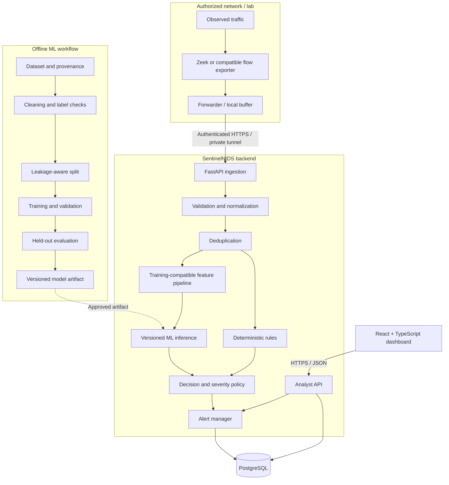

# SentinelNIDS — Complete Implementation Plan

> **Project:** Machine Learning–Based Network Intrusion Detection System (ML-NIDS)  
> **Document:** `IMPLEMENTATION_PLAN.md`  
> **Purpose:** End-to-end implementation roadmap from an empty repository to a tested, deployable full-stack web application  
> **Plan structure:** Five sequential phases with explicit deliverables, dependencies, and exit criteria  
> **Operating mode:** Passive detection and alerting on authorized network telemetry only  
> **Status:** Implementation plan; completion of a phase must be demonstrated by evidence, not assumed

---

## 1. Objective

Build SentinelNIDS as a complete, maintainable full-stack application that collects authorized network-flow telemetry, converts it into a consistent dataset, trains and evaluates a machine-learning model, runs the same feature transformations in production, detects suspicious activity, persists events and alerts, and presents findings in an authenticated web dashboard.

The project is complete when a test flow can be traced end to end:

**authorized traffic or approved PCAP → collection → normalization → feature pipeline → model/rules → API → PostgreSQL → dashboard → analyst review → audit record**

This plan is divided into five phases:

1. **Foundation and Data Collection**
2. **Data Pipeline, Dataset Preparation, and ML Training**
3. **Backend, Detection Engine, and Storage**
4. **Frontend and Full-Stack Integration**
5. **Hardening, Evaluation, Deployment, and Final Demonstration**

Phases are sequential, but individual tasks inside a phase may be parallelized when their dependencies and interfaces are already agreed.

## 2. Guiding rules

- Collect traffic only on networks and devices the team owns or is explicitly authorized to monitor.
- Start with flow metadata, not packet payload inspection. Do not upload or retain raw PCAPs in the cloud by default.
- Pick the telemetry source and feature schema before committing to a model. A model trained on one extractor's fields cannot automatically consume another extractor's fields.
- Keep data collection, offline training, and online inference reproducible.
- Keep the first release small: one modular FastAPI backend, PostgreSQL, one React + TypeScript frontend, and a separately deployed sensor/forwarder.
- Use deterministic rules alongside ML, but report which source produced each finding.
- A model score is not automatically a calibrated probability, and an alert is not proof of an attack.
- Do not automatically block traffic in this version.
- Never claim that a phase is complete until its exit criteria pass.
- Use Git branches and small, reviewable commits. Keep credentials, private captures, and unlicensed datasets out of the repository.

## 3. Target architecture



The offline training workflow is separate from production request handling. A model is promoted through evaluation and review; live alerts do not silently retrain the production model.

## 4. Repository structure target

The structure below is a target, not a requirement to create empty files on day one. Add files when the corresponding functionality is implemented.

```text
sentinelnids/
├── README.md
├── OVERVIEW.md
├── PRD.md
├── TRD.md
├── architecture.md
├── IMPLEMENTATION_PLAN.md
├── .gitignore
├── .env.example
├── docker-compose.yml
├── docs/
│   ├── data-dictionary.md
│   ├── model-card.md
│   ├── api.md
│   ├── deployment.md
│   ├── operations-runbook.md
│   └── evaluation-report.md
├── data/
│   ├── README.md
│   ├── raw/                 # ignored by Git
│   ├── interim/             # ignored by Git
│   ├── processed/           # ignored by Git unless approved samples
│   └── sample/              # small, safe, redistributable fixtures only
├── ml/
│   ├── notebooks/           # exploratory work; not production runtime
│   ├── src/
│   │   ├── ingest_dataset.py
│   │   ├── validate_data.py
│   │   ├── build_features.py
│   │   ├── train.py
│   │   ├── evaluate.py
│   │   └── package_model.py
│   ├── tests/
│   ├── artifacts/           # ignored by Git unless a small approved artifact
│   └── reports/
├── sensor/
│   ├── README.md
│   ├── config/
│   ├── forwarder.py
│   └── tests/
├── backend/
│   ├── app/
│   │   ├── main.py
│   │   ├── api/routes/
│   │   ├── core/
│   │   ├── schemas/
│   │   ├── services/
│   │   ├── ml/
│   │   └── db/
│   ├── migrations/
│   ├── tests/
│   ├── pyproject.toml
│   └── Dockerfile
├── frontend/
│   ├── src/
│   │   ├── api/
│   │   ├── components/
│   │   ├── features/
│   │   ├── layouts/
│   │   ├── pages/
│   │   └── types/
│   ├── package.json
│   └── Dockerfile
└── deploy/
    ├── proxy/
    ├── compose/
    └── scripts/
```

The team may simplify or rename folders, but should preserve clear separation between data/ML code, sensor collection, backend application, frontend, tests, and deployment.

---

# Phase 1 — Foundation and Data Collection

## Goal

Establish the repository, define the data contract, choose the telemetry source, collect or acquire permitted data, and prove that raw source records can be converted into a documented canonical flow format.

**Do not start by training a model on arbitrary columns.** First decide what the live sensor can reliably produce.

## 1.1 Project and environment setup

Tasks:

1. Create the Git repository and agree on the default branch and pull-request workflow.
2. Add `README.md`, `OVERVIEW.md`, `PRD.md`, `TRD.md`, `architecture.md`, and this implementation plan.
3. Add `.gitignore` entries for `.env`, virtual environments, `node_modules`, raw/private datasets, local databases, model artifacts, logs, caches, and generated reports where appropriate.
4. Add `.env.example` containing variable names and safe placeholders only.
5. Choose and document supported Python and Node.js versions.
6. Create a Python virtual environment for ML/backend work and a Node environment for the frontend.
7. Add baseline linting, formatting, and test commands.
8. Create a minimal CI workflow that runs on pull requests.
9. Define how code review, branches, commit messages, and release tags will work.

Deliverables:

- Clean repository with an initial commit.
- Setup instructions verified on a fresh checkout.
- No credentials or private data committed.
- Basic CI passing.

## 1.2 Choose the telemetry source

Select one primary source for v1:

- **Recommended:** Zeek connection logs or another well-documented flow exporter for authorized live metadata.
- **Offline testing:** approved PCAP fixtures processed with the selected parser/exporter.
- **Alternative:** a compatible flow exporter if its fields, units, licensing, and deployment constraints are documented.

Record:

- Where the sensor runs and which traffic it can observe.
- Whether it receives mirrored traffic, host traffic, or lab-generated traffic.
- The exact source tool and version.
- The source record fields and units.
- How timestamps, direction, missing fields, timeouts, and unsupported protocols are represented.
- Which data can be retained and for how long.
- What the sensor cannot observe.

A cloud VM does not automatically see traffic from a separate network. A sensor must be deployed where the authorized traffic is visible and send its metadata to the backend.

## 1.3 Select and document training datasets

Tasks:

1. Identify candidate public intrusion-detection datasets, such as CIC-IDS2017 or CSE-CIC-IDS2018, if suitable for the selected feature pipeline.
2. Verify the dataset's license/terms, provenance, label definitions, class balance, known limitations, and feature-generation method.
3. Record dataset version, source URL or acquisition details, acquisition date, checksums, and documentation.
4. Keep original data immutable; perform transformations on copies or generated intermediate data.
5. Do not put large, sensitive, or license-restricted datasets in Git.
6. Create a dataset manifest and a short data-card document.
7. If possible, collect benign flow metadata from a consented lab to test the live path. Keep the capture scope controlled and documented.
8. If generating lab attack-like traffic for validation, do so only in an isolated, authorized lab and record the procedure and labels.

Deliverables:

- Dataset inventory and provenance record.
- Data license/terms notes.
- Safe sample fixtures for tests, where redistribution is allowed.
- Documented sensor coverage and limitations.

## 1.4 Define the canonical flow schema

Before implementing the full pipeline, agree on a single normalized event contract.

Minimum candidate fields:

| Field | Meaning | Validation |
|---|---|---|
| `schema_version` | Canonical event schema version | Supported version |
| `event_id` | Stable event identifier | Required; idempotency key |
| `sensor_id` | Registered sensor | Must match authenticated sensor |
| `observed_at` | Sensor observation time | UTC timestamp; bounded skew |
| `src_ip`, `dst_ip` | Source/destination address | Valid IP format |
| `src_port`, `dst_port` | Ports where applicable | Integer 0–65535 or null if unsupported |
| `protocol` | Normalized protocol | Controlled vocabulary |
| `duration_ms` | Flow duration | Non-negative numeric |
| `packets_out`, `packets_in` | Directional packet counts, if available | Non-negative |
| `bytes_out`, `bytes_in` | Directional byte counts, if available | Non-negative |
| `received_at` | Backend receipt time | Assigned by backend |

Do not assume every source provides every field. Document which fields are required, optional, derived, or unavailable. The live model feature schema may be a subset or transformed version of this event schema.

Deliverables:

- `docs/data-dictionary.md`.
- Versioned schema and representative sanitized examples.
- Schema validation tests.
- Documented source-to-canonical mapping.

## 1.5 Implement a small collection and parsing path

Tasks:

1. Build a script or module to read approved exporter logs or PCAP-derived records.
2. Normalize source-specific field names and units into the canonical schema.
3. Handle malformed rows, truncated records, missing values, invalid timestamps, unsupported protocols, and parser exceptions.
4. Track counts of input records, accepted records, rejected records, and reasons for rejection.
5. Ensure one bad record does not crash processing of the entire file/batch.
6. Add tests using safe fixtures.
7. Avoid uploading packet payloads or full PCAPs to the cloud by default.

Deliverables:

- Working offline parser/collector.
- Sample normalized JSONL/CSV output with a documented schema.
- Tests for valid and invalid inputs.
- Data collection guide and limitations.

## Phase 1 exit gate

Phase 1 is complete only when:

- The repository can be set up from a clean checkout.
- Data provenance and authorized collection scope are documented.
- A selected telemetry source is able to produce records.
- The canonical schema and field units are documented and versioned.
- A repeatable parser converts sample source records into valid canonical events.
- Invalid records are rejected with measurable reasons.
- Tests pass and no private captures/secrets are accidentally committed.

**Do not move to full model training until the available training features and the chosen live sensor schema have a documented compatibility plan.**

---

# Phase 2 — Data Pipeline, Dataset Preparation, and ML Training

## Goal

Build a reproducible offline data pipeline, create leakage-aware train/validation/test splits, train and evaluate a baseline model, and package a versioned inference artifact that can be used by the backend without changing its feature semantics.

## 2.1 Build the offline data pipeline

Implement a repeatable pipeline with explicit inputs and outputs:

```mermaid
flowchart LR
    RAW["Raw dataset<br/>immutable"] --> PROFILE["Profile and validate"]
    PROFILE --> CLEAN["Clean and normalize"]
    CLEAN --> LABEL["Validate labels"]
    LABEL --> SPLIT["Train / validation / test split"]
    SPLIT --> FEATURES["Feature engineering"]
    FEATURES --> TRAIN["Train candidate models"]
    TRAIN --> EVAL["Held-out evaluation"]
    EVAL --> PACKAGE["Versioned model package"]
```



Tasks:

1. Implement dataset loading from documented source files.
2. Validate required columns, types, null counts, duplicates, impossible values, and label distribution.
3. Standardize column names and units where justified.
4. Inspect duplicates and near-duplicates before splitting.
5. Validate label mappings and merge or exclude labels only with a documented rationale.
6. Separate raw, interim, and processed outputs.
7. Make each stage repeatable from configuration and recorded commands.
8. Add a data validation report to each pipeline run.
9. Avoid silently dropping large numbers of rows; report how many rows were excluded and why.

Deliverables:

- Dataset loader and validation scripts.
- Data quality report.
- Label mapping document.
- Reproducible preprocessing commands.
- Tests for schema assumptions and data quality rules.

## 2.2 Prevent data leakage

Tasks:

1. Decide a split strategy before fitting transformations.
2. Prefer splits grouped by capture session, time, host, or scenario when those identifiers exist and are suitable.
3. Keep the test set untouched until model selection and threshold tuning are finished.
4. Fit imputers, encoders, scalers, feature selection, and the model only on training data.
5. Keep duplicate or near-duplicate flows from leaking across splits where feasible.
6. Document why the split is representative and its limitations.

Never fit a scaler, imputer, feature selector, or encoding map on the complete dataset before splitting.

## 2.3 Establish the target feature schema

This is a critical architecture gate.

Tasks:

1. Select the features the live telemetry source can produce or deterministically derive.
2. Compare dataset features with canonical live event fields.
3. Define exact feature names, ordering, units, aggregation windows, data types, and missing-value behavior.
4. Decide whether a feature can be calculated from available live data. If not, remove it from the candidate model or implement and validate the required extraction logic.
5. Build a feature transformation module shared by training and inference wherever practical.
6. Add parity tests that feed the same known records through offline and online transformation paths and compare the resulting feature vectors.
7. Reject unsupported schemas instead of silently filling unavailable values with zeros.
8. Document any fields retained for investigation but excluded from model inputs, such as IP addresses, to reduce shortcut learning and leakage.

Deliverables:

- Versioned feature schema.
- Feature engineering module.
- Training-serving parity tests.
- Feature availability matrix and documented limitations.

## 2.4 Train baseline models

Start with a simple, explainable baseline before trying complex models.

Tasks:

1. Establish a simple baseline, such as logistic regression or a random forest, depending on feature types and dataset size.
2. Use a scikit-learn `Pipeline` or equivalent to bundle preprocessing and model logic.
3. Handle class imbalance with a documented method where justified; avoid blindly oversampling before splitting.
4. Track random seeds, configuration, dataset version, dependency versions, and source commit.
5. Save experiment outputs and compare candidates using validation data.
6. Tune the alert threshold on validation data, not the test set.
7. Do not optimize solely for accuracy.

Deliverables:

- Training script and configuration.
- Baseline metrics and comparison report.
- Reproducible model pipeline.
- Clear model input/output contract.

## 2.5 Evaluate the model properly

Report, at minimum where applicable:

- Confusion matrix.
- Precision, recall, and F1.
- PR-AUC for imbalanced classification when suitable.
- Per-class and per-attack-category performance where labels support it.
- False positives per hour/day or another meaningful operational time window.
- Inference latency and approximate throughput.
- Class distribution, split strategy, and dataset limitations.
- Threshold selection rationale.
- Performance on a temporally distinct or locally collected sample where possible.

A high benchmark accuracy is not sufficient evidence of real-world usefulness. Public dataset performance may not generalize to a different network, exporter, traffic mix, or time period.

## 2.6 Package the model

Each released model artifact should include:

- Model version.
- Artifact SHA-256.
- Feature-schema version and ordered feature list.
- Complete preprocessing/model pipeline.
- Dataset identifiers/checksums.
- Training code commit and dependency versions.
- Training date and configuration.
- Evaluation report.
- Score semantics and approved threshold configuration.

Tasks:

1. Serialize only trusted, reviewed artifacts.
2. Verify the artifact can be loaded in a clean environment.
3. Add a smoke test using known feature vectors.
4. Store artifacts in a controlled local or release location; do not commit large artifacts by default.
5. Define how a new model is approved and how to roll back to the previous version.
6. Create a concise model card in `docs/model-card.md`.

Deliverables:

- Versioned model artifact and metadata.
- Evaluation report.
- Model card.
- Model loading and prediction smoke tests.
- Feature-schema compatibility tests.

## Phase 2 exit gate

Phase 2 is complete only when:

- The data pipeline is repeatable and produces validation reports.
- Labels and splits are documented, with leakage controls.
- The model uses features compatible with the selected live schema.
- Training and inference transformations pass parity tests.
- The baseline is evaluated on held-out data with relevant metrics.
- The artifact can be loaded and used in a clean environment.
- Model version, feature schema, artifact hash, and score semantics are documented.
- The team has stated what the model can and cannot reasonably claim to detect.

If feature parity cannot be proven, continue with data/schema work or deploy deterministic rules first. Do not present an incompatible model as a live detector.

---

# Phase 3 — Backend, Detection Engine, and Storage

## Goal

Build a secure FastAPI backend that authenticates sensors, validates and processes events, invokes the approved model, applies deterministic rules, manages alerts, and stores the results reliably in PostgreSQL.

## 3.1 Establish the backend skeleton

Tasks:

1. Create a Python 3.12 backend environment and dependency configuration.
2. Add FastAPI application startup/shutdown lifecycle.
3. Configure settings using environment variables and validated configuration.
4. Add structured logging and consistent error responses.
5. Add `/health/live` and `/health/ready`.
6. Add linting, formatting, and tests to CI.
7. Keep application configuration, schemas, API routes, services, and database code separated where useful.

Deliverables:

- Backend starts locally.
- OpenAPI documentation is available in development only or appropriately restricted.
- Configuration validation and health endpoints work.
- CI passes.

## 3.2 Implement PostgreSQL persistence

Create database migrations and a minimal relational schema.

Core entities:

- `users`: dashboard identities and roles.
- `sensors`: registered sensors, enabled state, schema version, and last-seen time.
- `flows`: accepted canonical events and timestamps.
- `predictions`: model output, model/feature versions, score, and inference status.
- `alerts`: analyst-facing findings, severity, status, summary, and deduplication key.
- `alert_events`: links related flows and evidence to alerts.
- `audit_events`: important administrative and analyst actions.
- `analyst_feedback`: optional structured review labels and notes.

Tasks:

1. Choose an ORM or database access approach and keep it consistent.
2. Add migrations rather than editing production schema manually.
3. Enforce uniqueness for `(sensor_id, event_id)` if event IDs are sensor-scoped.
4. Add indexes for common alert queries and timestamps.
5. Define transactions for flow/prediction/alert persistence.
6. Add connection pooling and sensible timeouts.
7. Use a least-privilege database account for the application.
8. Test migrations against a clean database and an upgrade from the prior schema.
9. Define retention and backup policy.

Deliverables:

- PostgreSQL schema and migrations.
- Database access layer.
- Tests for uniqueness, transactions, and failure cases.
- Documented local database setup.

## 3.3 Implement sensor authentication and ingestion

API endpoint:

- `POST /api/v1/ingest/flows`

Tasks:

1. Register each sensor with a unique credential.
2. Store a hash/reference of the credential where practical; never log reusable secrets.
3. Implement credential rotation, disable/revoke behavior, and per-sensor scoping.
4. Authenticate before processing expensive payloads.
5. Validate body size, batch size, schema version, field types, timestamps, IPs, ports, counters, and rate limits.
6. Use stable event IDs for idempotency.
7. Return explicit accepted/rejected/duplicate results.
8. Ensure the API does not claim durable acceptance before the configured persistence point.
9. Add tests for valid, invalid, expired/revoked, duplicated, and oversized requests.

Deliverables:

- Authenticated ingestion endpoint.
- Canonical schema validation.
- Per-sensor authorization and rate limits.
- Stable error codes and response schema.
- Integration tests for duplicate and invalid events.

## 3.4 Implement normalization and feature parity

Tasks:

1. Map the chosen sensor/exporter format into the canonical schema.
2. Keep source-specific parsing separate from canonical validation.
3. Invoke the exact approved feature pipeline from Phase 2.
4. Verify the feature-schema version before inference.
5. Reject incompatible inputs with a measurable error.
6. Store schema/version metadata with each event/prediction.
7. Add integration tests from real sanitized sensor fixtures through the online feature pipeline.

Deliverables:

- Tested normalization service.
- Runtime feature adapter.
- Schema compatibility checks.
- Parity integration tests.

## 3.5 Integrate ML inference

Tasks:

1. Load a pinned trusted model artifact at application startup.
2. Verify model metadata and artifact hash.
3. Expose a small inference service used by the detection pipeline.
4. Record model version, feature-schema version, score/class, status, and latency.
5. Handle model load failures and per-event inference errors explicitly.
6. Do not label failed inference as benign.
7. Add model readiness and prediction smoke tests.
8. Keep model updates out of the request path; release models through a reviewed deployment process.

Deliverables:

- Versioned inference service.
- Startup validation and readiness integration.
- Inference tests and structured failure handling.

## 3.6 Implement deterministic rules and decision policy

Start with a small, tested ruleset:

- Connection-rate threshold over a defined time window.
- Many distinct destination ports from a source over a defined window, indicating a possible scan.
- Additional rules only when a clear requirement and test case exist.

Tasks:

1. Define versioned configuration for rule ID, description, threshold/window, severity, enabled flag, and exclusions.
2. Test boundary values, time windows, repeated events, and benign high-volume behavior.
3. Keep rule findings distinct from ML predictions.
4. Define explicit policy for model-only, rule-only, conflicting, and inference-unavailable cases.
5. Configure alert thresholds based on validation and operational testing.
6. Do not automatically block traffic.

Deliverables:

- Rule engine and versioned configuration.
- Decision policy.
- Unit tests and representative scenarios.
- Documented severity/score semantics.

## 3.7 Implement alert lifecycle and APIs

Required endpoints:

| Method | Endpoint | Purpose |
|---|---|---|
| `GET` | `/api/v1/alerts` | Paginated/filterable alert list |
| `GET` | `/api/v1/alerts/{alert_id}` | Alert evidence and related events |
| `PATCH` | `/api/v1/alerts/{alert_id}` | Update permitted review state |
| `GET` | `/api/v1/dashboard/summary` | Dashboard counts and trends |
| `GET` | `/api/v1/sensors` | Sensor state and last-seen time |
| `GET` | `/api/v1/model` | Active model/schema metadata |
| `GET` | `/health/live` | Process liveness |
| `GET` | `/health/ready` | Dependency/model readiness |

Tasks:

1. Create alerts from rule and/or model findings.
2. Implement deduplication with a documented key and time window.
3. Retain references to all related flow events.
4. Support review states such as `new`, `acknowledged`, `investigating`, `resolved`, and `false_positive`, with validated transitions.
5. Record reviewer and timestamps.
6. Add audit records for state changes and sensitive operations.
7. Add filters by time, severity, status, sensor, rule/type, protocol, and supported IP metadata.
8. Validate query parameters, enforce maximum page sizes, and add indexes.
9. Add role-based access checks to every protected endpoint.

Deliverables:

- Alert manager and lifecycle.
- Analyst and dashboard APIs.
- Audit logging for review actions.
- API tests for filtering, pagination, authorization, and state changes.

## 3.8 Implement operational behavior

Tasks:

- Add JSON logs with request IDs and stable error codes.
- Track ingestion accepted/rejected/duplicate counts, API latency, inference latency/errors, alert volume, database failures, and sensor freshness.
- Redact secrets and avoid raw payload logging.
- Add request/body limits, timeouts, and rate limits.
- Define database failure behavior and retry semantics.
- Document the forwarder's bounded retry/buffer policy.
- Add retention and backup instructions.

## Phase 3 exit gate

Phase 3 is complete only when:

- PostgreSQL migrations work on a clean database.
- A valid authenticated sensor batch is accepted and persisted.
- Invalid, oversized, unauthorized, and duplicate batches are handled safely.
- A supported event passes normalization, feature transformation, model inference, and deterministic rules.
- A resulting alert persists with evidence and version metadata.
- Alert list/detail/review APIs work with authorization and pagination.
- Important analyst actions are audited.
- Model/database failures are visible and never misrepresented as benign detections.
- Integration tests pass.

---

# Phase 4 — Frontend and Full-Stack Integration

## Goal

Build the React + TypeScript web application, connect it to the backend APIs, and demonstrate the full user workflow from system overview through alert investigation and review.

## 4.1 Set up the frontend

Tasks:

1. Create the React + Vite + TypeScript application.
2. Configure linting, formatting, type checking, and production build.
3. Add environment-based API base URL configuration.
4. Create a typed API client and shared request/error handling.
5. Define reusable components for tables, filters, status labels, loading states, errors, and charts.
6. Establish routing and a consistent responsive layout.
7. Keep secrets and database access out of the frontend bundle.

Deliverables:

- Frontend runs locally.
- Production build succeeds.
- Typed API client and common UI patterns exist.

## 4.2 Implement authentication and authorization UX

Tasks:

1. Implement sign-in and sign-out using the chosen backend identity mechanism.
2. Handle expired sessions and unauthorized responses.
3. Show permitted actions based on role while retaining all authorization checks on the backend.
4. Prefer secure, HttpOnly, SameSite cookies for browser sessions when compatible with the chosen authentication design; protect state-changing requests against CSRF if cookie-based auth is used.
5. Do not store privileged sensor credentials in the browser.
6. Provide clear unauthorized, session-expired, and network-error states.

Deliverables:

- Authenticated dashboard route.
- Session handling.
- Role-aware interface and backend-enforced permissions.

## 4.3 Build the overview dashboard

Show the information that is operationally useful, not just decorative charts:

- Total flows/events over a selected period.
- Alerts grouped by severity and review state.
- Alert timeline.
- Most common alert/rule categories.
- Sensor last-seen/freshness and ingestion health.
- Active model version and feature-schema version.
- Recent inference errors or system warnings, where available.

Tasks:

1. Connect to `GET /api/v1/dashboard/summary`.
2. Define each metric and its time window.
3. Show empty, loading, stale-data, and partial-failure states.
4. Avoid implying that missing sensor data means the network is safe.
5. Use charts that remain readable at realistic data volumes.

Deliverables:

- Responsive overview page.
- Correctly sourced summary metrics.
- Documented metric definitions.

## 4.4 Build alert list, filtering, and detail views

Alert list:

- Pagination.
- Time range.
- Severity.
- Status.
- Sensor.
- Rule/type.
- Protocol and source/destination metadata where collected.
- Search where the API supports it.

Alert detail:

- Alert summary and severity.
- First/last seen time.
- Related events and observed flow metadata.
- Matched rule IDs and evidence.
- Model score with correct semantics.
- Model, feature-schema, and rule-set versions.
- Review history and permitted state transitions.

Tasks:

1. Connect list and detail views to the corresponding APIs.
2. Keep filter state reflected in the URL where practical.
3. Provide clear no-results and API-error states.
4. Escape/render event content safely; never treat network-derived fields as trusted HTML.
5. Confirm that UI filters correspond to backend filters and indexes.

Deliverables:

- Functional alert list/detail pages.
- Filter and pagination behavior.
- Clear evidence and version display.

## 4.5 Build sensor and model status views

Sensor view:

- Sensor ID/name.
- Enabled/disabled state.
- Last-seen time.
- Schema version.
- Accepted/rejected event counts where available.
- Recent delivery errors where safe to show.

Model view:

- Active model version.
- Feature-schema version.
- Artifact metadata/hash where appropriate.
- Model readiness.
- Recent inference latency and error summaries.

Do not expose reusable API keys, private filesystem paths, environment variables, or other secrets.

## 4.6 Integrate the analyst review workflow

Tasks:

1. Add review-state controls for authorized roles.
2. Require confirmation for consequential status changes where appropriate.
3. Submit changes to the backend and refresh the affected record.
4. Show success/failure from the actual API response, not optimistic assumptions.
5. Display reviewer and timestamps from audit/history APIs if exposed.
6. Collect structured false-positive/true-positive feedback without automatically changing the production model.

Deliverables:

- End-to-end alert review flow.
- Validated error and permission handling.
- Audit trail visible where required.

## 4.7 Full-stack integration tests

Verify this complete sequence:

1. Start the backend and PostgreSQL.
2. Authenticate a test sensor.
3. Submit a valid test batch.
4. Verify accepted records are stored.
5. Verify the model/rules produce the expected result for the test fixture.
6. Verify an alert is created and persisted.
7. Sign in as an analyst.
8. Find the alert in the dashboard.
9. Open the detail page and inspect its evidence.
10. Change the alert review state.
11. Verify the new state and audit record in the backend.
12. Confirm unauthorized users cannot access protected data or modify the alert.

Deliverables:

- Integration test suite.
- Browser smoke test or documented manual test script.
- Sanitized screenshots for the project report/demo.
- Known-issues list.

## Phase 4 exit gate

Phase 4 is complete only when:

- Frontend production build and TypeScript checks pass.
- Dashboard authentication works.
- Overview metrics come from real backend data.
- Alert list, filtering, detail, and review actions work end to end.
- Sensor and model status are visible.
- Loading, empty, stale, error, and unauthorized states are handled.
- A test event is visible in the dashboard after ingestion and processing.
- The backend remains the source of truth for permissions and alert states.

---

# Phase 5 — Hardening, Evaluation, Deployment, and Final Demonstration

## Goal

Make the full-stack application reproducible, secure for its intended deployment, observable, recoverable, and ready for a defensible academic demonstration with documented evaluation results and limitations.

## 5.1 End-to-end verification and quality gates

Run:

- Backend unit and integration tests.
- Frontend lint/type/build checks.
- Database migration tests.
- API authentication/authorization tests.
- ML feature-parity and artifact-loading tests.
- Full end-to-end tests from approved sample telemetry to visible alert.
- Duplicate/retry and malformed-input tests.
- Database/model failure tests.
- Basic load tests with documented event volumes and environment.
- Manual review of the dashboard and responsive behavior.

Create a test matrix showing test ID, purpose, input, expected result, actual result, and pass/fail. Fix critical failures before deployment.

## 5.2 Security hardening

Checklist:

- [ ] TLS enabled for external traffic.
- [ ] PostgreSQL is not publicly exposed.
- [ ] Sensor and human credentials are separate.
- [ ] Credentials can be revoked/rotated.
- [ ] Secrets are absent from Git history, frontend bundles, images, and logs.
- [ ] Authentication and role checks cover every protected API.
- [ ] CORS is restricted to approved origins.
- [ ] Request size, batch size, rate, and timeouts are bounded.
- [ ] Database uses least-privilege credentials.
- [ ] Model artifact is trusted, pinned, and hash-verified.
- [ ] Dependencies and container images are scanned where tooling permits.
- [ ] Debug mode and public interactive API docs are disabled or restricted in production.
- [ ] Audit records cover important review/admin actions.
- [ ] Retention, export, and privacy behavior is documented.
- [ ] Network-derived text is rendered safely in the frontend.

Do not describe the application as “secure” merely because it uses HTTPS. Security depends on the complete configuration and tested controls.

## 5.3 Containerize the application

Use Docker for repeatable builds.

Suggested services for a small deployment:

- `api`: FastAPI application.
- `web`: static frontend build served by a web server, if not served through the proxy.
- `proxy`: Caddy/Nginx for TLS and routing.
- `db`: PostgreSQL for a controlled single-host deployment, or use a managed database.

Tasks:

1. Create Dockerfiles with pinned dependencies/base images.
2. Use non-root users where practical.
3. Keep the database on a private network.
4. Configure persistent storage for PostgreSQL.
5. Add health checks and restart policies.
6. Add log rotation and resource limits.
7. Load secrets at runtime, not during image build.
8. Ensure the compose file does not expose PostgreSQL publicly.
9. Test clean startup, shutdown, restart, migration, and persistence.

Deliverables:

- Dockerfiles and Compose configuration.
- Environment example and setup instructions.
- Verified restart/persistence behavior.
- Deployment topology diagram.

## 5.4 Deploy to staging first

Tasks:

1. Provision a Linux VM or appropriate managed hosting environment.
2. Configure DNS, TLS, firewall/security group, and restricted administrative access.
3. Deploy the backend, frontend, and database using the approved topology.
4. Deploy the sensor/forwarder separately on the authorized network.
5. Configure sensor credentials and backend environment secrets.
6. Run migrations and smoke tests.
7. Confirm ingestion, inference, persistence, dashboard, health checks, logs, and metrics.
8. Test sensor disconnect/reconnect and backend restart.
9. Test database backup and restore.
10. Confirm the rollback process using a known-good application image and model artifact.

Do not connect a production deployment to arbitrary networks or capture traffic without explicit authorization.

## 5.5 Observability and operating procedures

Track at least:

- Accepted, rejected, and duplicate events.
- Ingestion request rate and latency.
- End-to-end processing and inference latency.
- Model inference errors.
- Alert counts by rule/severity.
- Sensor last-seen age.
- Database errors and transaction latency.
- Forwarder retry/buffer/drop counts where available.
- API authentication failures and error rates.

Write short runbooks for:

- Sensor offline or stale.
- Ingestion rejection spike.
- Database unavailable.
- Model failed to load or inference errors increased.
- Alert volume suddenly increased.
- Bad model/rule release.
- Backup restore and application rollback.

## 5.6 Final model and system evaluation

The final report should distinguish offline model performance from end-to-end application performance.

### ML evaluation

- Dataset and label provenance.
- Dataset size and class distribution.
- Train/validation/test split strategy.
- Leakage controls.
- Confusion matrix, precision, recall, F1, and PR-AUC where suitable.
- Per-class results.
- Threshold selection method.
- False positives per hour/day on the tested traffic.
- Known limitations and potential distribution shift.

### System evaluation

- Test environment and hardware.
- Ingestion throughput (events/flows per second).
- p50/p95 latency for ingestion and detection.
- Inference latency and error rate.
- Behavior under duplicates, malformed input, sensor interruption, and database outage.
- Observed event loss or retry behavior under the tested workload.
- Dashboard response times and query behavior.
- Backup/restore and rollback test results.

Use measured results only. Do not invent accuracy, throughput, latency, or production-readiness claims.

## 5.7 Prepare final demonstration and documentation

Required deliverables:

- Updated `README.md` with setup, architecture, and demo instructions.
- `docs/data-dictionary.md`.
- `docs/model-card.md`.
- `docs/evaluation-report.md`.
- `docs/deployment.md`.
- `docs/operations-runbook.md`.
- API documentation and example requests.
- Sanitized screenshots of overview, alerts, alert detail, sensor status, and model status.
- Architecture diagram and implementation status summary.
- Test matrix with results.
- Known limitations and future improvements.
- Short demo script with a reproducible test input.

Suggested demonstration sequence:

1. Show the architecture and explain that a sensor is required for live visibility.
2. Show the chosen telemetry source and an approved test flow/fixture.
3. Submit a test batch and show ingestion acknowledgement.
4. Show normalization and the model/feature version used.
5. Show the generated rule/ML evidence and alert in PostgreSQL/API.
6. Open the dashboard and filter to the alert.
7. Review the evidence and update the alert state.
8. Show that the review action is persisted and audited.
9. Present the evaluation metrics and limitations.
10. Explain deployment, monitoring, and rollback.

## Phase 5 exit gate

Phase 5 is complete only when:

- CI passes the agreed test suite.
- Security and configuration checklists are reviewed.
- Staging deployment is reproducible from documented steps.
- Only required ports are exposed and PostgreSQL is private.
- Health checks, logs, and key metrics work.
- Backup restore and rollback have been tested.
- ML and system evaluation reports contain measured results.
- The end-to-end demo can be repeated from a clean state.
- Limitations and unimplemented features are stated honestly.

---

# 5. Cross-phase dependency map

| Workstream | Starts in | Depends on | Must be proven before |
|---|---|---|---|
| Repository/environment | Phase 1 | None | All development |
| Sensor/source selection | Phase 1 | Authorized deployment context | Feature-schema design |
| Dataset acquisition | Phase 1 | Provenance/license checks | Training |
| Canonical event schema | Phase 1 | Sensor field mapping | Backend contract and online pipeline |
| Offline data pipeline | Phase 2 | Dataset and schema knowledge | Model training |
| Feature engineering | Phase 2 | Compatible available features | Model release |
| Model training/evaluation | Phase 2 | Leakage-aware data and feature schema | Live inference |
| PostgreSQL schema | Phase 3 | Event, alert, and user requirements | Durable APIs |
| Ingestion and authentication | Phase 3 | Canonical event schema | Sensor-to-backend integration |
| Online inference | Phase 3 | Approved model artifact and parity tests | ML-driven alerts |
| Alert APIs | Phase 3 | Storage and decision policy | Frontend integration |
| Dashboard | Phase 4 | Stable API contracts | Full-stack demo |
| Deployment/security | Phase 5 | Working full stack | Final release |
| Evaluation/reporting | Phases 2–5 | Data/model/system test results | Final demonstration |

# 6. Minimum viable release versus later improvements

## Required for the first complete release

- One documented authorized telemetry source.
- Canonical flow schema and validation.
- Reproducible offline data preparation.
- A baseline model with honest held-out evaluation, if feature compatibility is proven.
- Deterministic rules as a separately identifiable detection path.
- Versioned model and feature schema.
- FastAPI ingestion and analyst APIs.
- PostgreSQL persistence and migrations.
- Sensor and analyst authentication.
- Alert deduplication and review lifecycle.
- React dashboard with overview, alert list/detail, filtering, sensor status, and model status.
- Docker deployment, TLS, health checks, logs, metrics, backup/restore, and rollback instructions.
- End-to-end tests and final evaluation report.

## Add only when evidence or a concrete requirement justifies it

- Kafka or another durable event-stream platform.
- Separate model-serving service.
- Kubernetes or multi-region deployment.
- Complex SOAR integrations or automatic response.
- Multi-tenant billing.
- Multiple competing dashboards.
- Online learning or automatic retraining.
- Deep packet inspection and packet-payload retention.
- High availability and horizontal scaling beyond measured needs.

These are not prerequisites for demonstrating a useful, secure, end-to-end ML-NIDS.

# 7. Definition of complete

SentinelNIDS is complete for the agreed v1 scope when a reviewer can clone the repository, follow the setup instructions, run the services, submit a valid approved test event, see validation and detection execute using the documented feature schema, retrieve the persisted alert in the dashboard, review the alert, and reproduce the published evaluation results.

The final system must clearly state what it observes, what it detects, how the model was evaluated, how false positives are handled, and which limitations remain. A polished frontend alone—or a strong offline model without a working sensor-to-dashboard path—does not satisfy the full-stack project goal.
