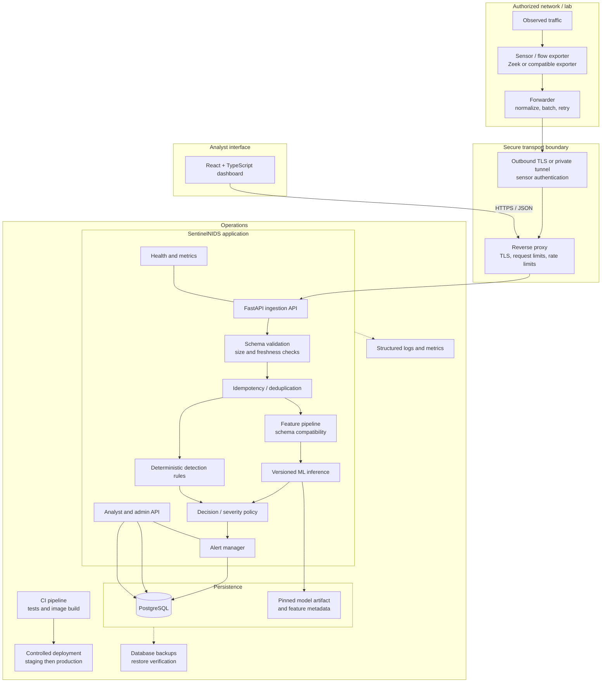

# SentinelNIDS — System Architecture

> **Project:** Machine Learning–Based Network Intrusion Detection System (ML-NIDS)  
> **Document:** `architecture.md`  
> **Status:** Proposed implementation architecture for v1  
> **Last updated:** 28 October 2026

## 1. Purpose

This document defines the system architecture for SentinelNIDS: the runtime components, data flow, module boundaries, APIs, data model, security controls, deployment topology, model lifecycle, failure handling, and verification strategy.

SentinelNIDS is a **flow-based, passive network intrusion detection system**. It receives metadata from networks or lab environments that the operator owns or is explicitly authorized to monitor, scores supported flow records using a versioned ML pipeline, applies deterministic detection rules, persists findings, and presents them to authenticated analysts.

This is an implementation blueprint, not a claim that the system is already production-ready. Production readiness depends on completing the controls and tests described here.

## 2. Architecture principles

1. **Passive by default:** observe and alert; do not block traffic or modify firewall rules.
2. **Authorized collection only:** the sensor runs on an approved host/interface or processes approved PCAPs.
3. **Metadata-first:** do not upload packet payloads or retain full PCAPs in the cloud by default.
4. **Training-serving parity:** the runtime feature pipeline must match the pipeline used to train and evaluate the model.
5. **One deployable backend first:** use a modular FastAPI application and PostgreSQL before adding queues, microservices, Kubernetes, or a separate inference service.
6. **Explainable alerts:** record the rule/model version and evidence that led to each finding.
7. **Fail visibly, not silently:** malformed inputs, unavailable dependencies, unsupported schemas, and model errors must be measured and surfaced.
8. **Secure by default:** authenticated ingestion, role-based dashboard access, TLS, secret management, bounded requests, audit records, and least privilege.
9. **Reproducible ML:** version datasets, feature schemas, training code, thresholds, and model artifacts.
10. **Evidence-based claims:** evaluate on held-out data and report false positives, precision, recall, latency, and throughput—not accuracy alone.

## 3. Scope and boundaries

### In scope for v1

- Ingest normalized network-flow metadata from one or more authorized sensors.
- Support a controlled offline PCAP workflow for development and testing.
- Validate and normalize events using a versioned schema.
- Apply a versioned feature pipeline and a trained model when compatible features are available.
- Apply deterministic rules, combine results according to documented policy, and create deduplicated alerts.
- Store flows, predictions, alerts, sensor health, user actions, and audit records in PostgreSQL.
- Expose authenticated, versioned APIs.
- Provide a React + TypeScript analyst dashboard.
- Ship a Docker-based deployment, health checks, structured logs, metrics, backup instructions, and rollback instructions.

### Out of scope for v1

- Automatic traffic blocking, firewall changes, packet injection, or active scanning.
- Deep packet inspection, payload capture, or TLS decryption.
- Guaranteed detection of every attack or zero-day.
- A full Security Orchestration, Automation and Response (SOAR) platform.
- Complex multi-tenant billing, a microservice for every module, or Kubernetes without demonstrated need.
- Cloud storage of raw PCAP files by default.
- Treating a benchmark score as proof of real-world performance.

## 4. High-level system architecture



The diagram is logical, not a claim that all boxes must be separate processes. For v1, ingestion, validation, inference, rules, alert management, and APIs can be modules in one FastAPI application. PostgreSQL is the durable source of truth. The sensor and forwarder run on the authorized monitored network, separate from the cloud backend.

## 5. Runtime components and responsibilities

| Component | Responsibility | Important contract |
|---|---|---|
| Sensor / flow exporter | Observe approved traffic and emit connection/flow metadata | Emits only fields supported by the chosen schema |
| Forwarder | Validate basic record shape, batch, authenticate, retry, and buffer briefly | Bounded local buffer; no unbounded memory growth |
| Reverse proxy | Terminate HTTPS, enforce request-size and connection limits, route requests | No public unauthenticated ingestion |
| Ingestion API | Authenticate sensor, validate batches, reject unsupported schema versions | Returns per-batch or per-event acceptance status |
| Normalizer | Convert source-specific fields into canonical field names and units | Deterministic, tested transformations |
| Deduplication | Prevent duplicate accepted events from repeated delivery | Stable event key and documented retention window |
| Feature pipeline | Convert canonical flow into model input | Same columns, units, ordering, missing-value behavior, and transforms as training |
| ML inference | Load pinned pipeline and produce score/class | Returns model version and inference timing |
| Rule engine | Apply deterministic thresholds and behavioral rules | Rule IDs and evidence are attached to findings |
| Decision policy | Combine model and rule outputs using explicit policy | Model score is not called a probability unless calibrated |
| Alert manager | Create/update alerts, suppress duplicates, track review state | Database transaction and unique constraints enforce consistency |
| PostgreSQL | Persist flows, alerts, sensors, model metadata, feedback, and audit events | Durable source of truth |
| FastAPI analyst API | Serve filtered alerts, summaries, sensor state, and model metadata | Authentication, authorization, pagination, validation |
| React dashboard | Visualize status, trends, alerts, and evidence | Never contains database credentials or sensor secrets |
| Operations layer | Logs, metrics, health checks, backup, deployment, rollback | Failures are observable and recoverable |

### 5.1 Deployment process boundaries

For v1, the following can be separate containers:

- `api`: FastAPI application and CPU inference.
- `db`: PostgreSQL for a small controlled deployment, or an external managed PostgreSQL instance.
- `web`: compiled React static assets served by a web server or the reverse proxy.
- `proxy`: Caddy or Nginx for TLS and routing, depending on deployment topology.

The sensor/forwarder is deployed separately in the monitored network. Do not put the sensor inside the public backend container and assume that doing so gives the cloud server access to traffic on another network.

## 6. Main data flow

### 6.1 Flow ingestion

1. The authorized sensor observes traffic and exports flow metadata.
2. The forwarder normalizes supported source fields and groups records into bounded batches.
3. It sends a request over TLS using a sensor-specific credential or mutual TLS.
4. The API authenticates the sensor before accepting data.
5. The API checks payload size, schema version, field types, timestamp range, required fields, and per-sensor rate limits.
6. Each record is assigned or checked for a stable event ID. Duplicate deliveries are handled idempotently.
7. Valid records are persisted or processed according to the chosen transaction strategy. Rejected records receive a reason that can be measured without logging secrets or excessive traffic details.
8. The API returns an explicit acknowledgement. The forwarder retries transient failures with bounded exponential backoff and jitter; it does not retry permanent validation/authentication errors indefinitely.

### 6.2 Detection and alert creation

1. The canonical event is mapped to the model's declared feature schema.
2. The feature pipeline rejects incompatible inputs rather than silently inventing values.
3. The pinned model pipeline generates a score/class and records its version.
4. The deterministic rule engine evaluates configured behavioral rules independently.
5. A decision policy maps rule hits and model output to `normal`, `review`, or `alert` states and an appropriate severity.
6. The alert manager deduplicates related findings using a documented key and time window.
7. Flow, prediction, alert, and audit updates are committed with appropriate database constraints/transactions.
8. The dashboard retrieves the alert through the authenticated API and displays the evidence and model/rule versions.

**Important:** A model score is a ranking score unless probability calibration has been measured and validated. An alert means “requires investigation,” not “attack confirmed.”

### 6.3 Analyst review

1. An authenticated analyst opens an alert and reviews the timestamp, source/destination metadata, matched rules, model score, and versions.
2. The analyst changes its state to `acknowledged`, `investigating`, `resolved`, or `false_positive` according to the supported workflow.
3. The API checks authorization and validates the state transition.
4. The system records who made the change, when, and the previous/new state in an audit record.
5. Analyst feedback can be exported for evaluation; it must not silently retrain or replace the production model.

## 7. Canonical event and detection contracts

### 7.1 Normalized flow event

Use one documented schema between the sensor/forwarder, API, database, and detection pipeline. The example below is illustrative and is not a universal mapping from Zeek or another exporter.

```json
{
  "schema_version": "1.0",
  "event_id": "d13c6c38-2f1e-4e0c-98db-c8f14790d842",
  "sensor_id": "lab-sensor-01",
  "observed_at": "2026-10-28T10:00:00Z",
  "received_at": "2026-10-28T10:00:01Z",
  "src_ip": "192.0.2.10",
  "dst_ip": "198.51.100.20",
  "src_port": 51234,
  "dst_port": 443,
  "protocol": "tcp",
  "duration_ms": 125,
  "packets_out": 8,
  "packets_in": 12,
  "bytes_out": 820,
  "bytes_in": 2400
}
```

- Use UTC timestamps in ISO 8601 format.
- Use explicit units in field names or schema documentation.
- Validate IP addresses, port ranges, protocol values, non-negative counters, and timestamp bounds.
- Treat `event_id` as an idempotency key scoped to a sensor unless globally unique IDs are guaranteed.
- IP addresses and ports are normally retained as investigation metadata; use them as model features only when justified and tested for leakage/generalization.
- Do not log entire payloads for validation failures by default.

### 7.2 Detection result

```json
{
  "event_id": "d13c6c38-2f1e-4e0c-98db-c8f14790d842",
  "decision": "review",
  "severity": "medium",
  "model_version": "flow-v1.0.0",
  "feature_schema_version": "1.0",
  "model_score": 0.87,
  "matched_rules": ["CONNECTION_RATE_HIGH"],
  "reasons": ["Connection rate exceeded configured threshold"],
  "evaluated_at": "2026-10-28T10:00:01Z"
}
```

The score and threshold values are examples only. Configure and validate thresholds using validation data and a documented operational policy. Keep rule-based evidence distinct from ML evidence.

### 7.3 Schema versioning

- Every incoming event declares a schema version.
- Every model artifact declares the exact feature-schema version it expects.
- The API rejects unsupported major versions with a clear error.
- Compatible additive changes require tests and an explicit compatibility policy.
- Never silently map a missing required feature to zero unless that exact behavior is part of the trained and validated preprocessing pipeline.
- Record the event schema, feature schema, model version, and rule-set version on the resulting prediction/alert.

## 8. ML training, release, and inference architecture

### 8.1 Offline training workflow

```mermaid
flowchart LR
    DATA["Versioned dataset<br/>provenance and checksum"] --> SPLIT["Leakage-aware split"]
    SPLIT --> TRAIN["Fit preprocessing<br/>and candidate model"]
    TRAIN --> VALIDATE["Validate thresholds<br/>and compare baselines"]
    VALIDATE --> EVAL["Held-out evaluation<br/>and error analysis"]
    EVAL --> PACKAGE["Package pipeline<br/>metadata and hash"]
    PACKAGE --> APPROVE["Review and approve<br/>model release"]
    APPROVE --> REGISTRY["Versioned artifact<br/>release location"]
    REGISTRY --> DEPLOY["Deploy to staging<br/>then production"]
```



The training pipeline is offline and separate from request-time inference. It should not be triggered automatically by incoming alerts.

### 8.2 Dataset and evaluation controls

- Record dataset name/version, license/provenance, class distribution, label semantics, preprocessing code, random seeds where relevant, and checksums.
- Split before fitting transformations. Prefer grouped, capture-session, host, or time-aware splits where possible to reduce leakage.
- Fit imputers, encoders, scalers, feature selection, and model parameters on training data only.
- Tune thresholds on validation data; reserve the test set for final evaluation.
- Compare a simple baseline such as logistic regression or random forest before considering more complex algorithms.
- Report precision, recall, F1, PR-AUC where suitable, confusion matrix, per-class performance, false alerts per hour/day, and inference latency.
- Evaluate temporal or local traffic where available. Public benchmark results alone do not prove live effectiveness.
- Document limitations and label uncertainty.

### 8.3 Model artifact contract

Each released artifact should include:

- Unique model version and artifact SHA-256.
- Feature-schema version and ordered feature list.
- Preprocessing and classifier pipeline.
- Training dataset identifiers and checksums.
- Training code commit, dependency versions, and creation date.
- Evaluation report and approved threshold/configuration.
- Expected input types, missing-value rules, and output semantics.

Load a pinned, trusted artifact at startup. Verify its hash and metadata before serving requests. Do not load model artifacts uploaded by untrusted users or from mutable public URLs. Only promote a model after validation; retain the previous known-good version for rollback.

### 8.4 Runtime inference behavior

- CPU inference is the v1 default.
- Keep inference bounded and measure p50/p95 latency and error rate.
- Reject unsupported feature schemas and malformed feature vectors.
- Return model version with every prediction.
- Expose model readiness separately from process liveness.
- If inference fails, record a bounded error and follow an explicit policy: do not label the event benign. Preserve the event and expose the failure for retry/review, or mark it as `inference_unavailable`.
- Do not auto-retrain from live traffic or analyst feedback without a separately reviewed training and release process.

## 9. Detection policy

### 9.1 Deterministic rules

Start with a small set of understandable rules, such as:

- Connection-rate threshold over a defined time window.
- Many distinct destination ports from one source over a defined window, indicating a possible scan.
- Optional protocol- or service-specific thresholds where evidence supports them.

Every rule needs an ID, description, enabled flag, threshold/window, severity, exclusions where necessary, version, and tests. Avoid universal thresholds that are not calibrated to the environment. Benign scanners, monitoring systems, NAT, load balancers, and busy services can create false positives.

### 9.2 Combining model and rule results

Use a small explicit decision policy, not hidden logic:

- A rule match can produce a finding even when the model score is low.
- A high model score can trigger `review` according to a validation-backed threshold.
- Conflicting outputs should be retained as evidence rather than discarded.
- Severity mapping must be configurable and documented.
- Duplicates can be grouped into one alert while retaining references to all relevant events.
- No detection result automatically blocks traffic in v1.

## 10. Backend and API architecture

### 10.1 Backend module layout

```text
backend/
  app/
    main.py                  # FastAPI application and lifecycle
    api/
      routes/
        ingest.py            # Sensor flow ingestion
        alerts.py            # Alert list/detail/review
        dashboard.py         # Summary metrics
        sensors.py           # Sensor status
        model.py             # Active model metadata
        health.py            # Liveness/readiness
    core/
      config.py              # Validated environment configuration
      security.py            # Sensor and user authentication
      logging.py             # Structured logging and redaction
      errors.py              # Consistent error responses
    schemas/
      flow.py                # Canonical event schema
      detection.py           # Prediction/alert schemas
      api.py                 # API request/response contracts
    services/
      ingestion.py           # Validation and idempotent ingestion
      normalization.py       # Source-to-canonical mapping
      features.py            # Training-compatible feature pipeline
      inference.py           # Model loading and prediction
      rules.py               # Deterministic detection rules
      decision.py            # Rule/model decision policy
      alert_manager.py       # Alert lifecycle and deduplication
      sensor_health.py       # Last-seen/freshness tracking
    db/
      session.py             # Database sessions
      models.py              # ORM entities
      migrations/             # Versioned schema migrations
    ml/
      artifact_metadata.py   # Model metadata validation
    tests/
      unit/
      integration/
      e2e/
  pyproject.toml
  Dockerfile
```

This is a suggested structure, not a requirement to create every file immediately. Keep boundaries where they improve testability; do not create empty abstractions just to match the tree.

### 10.2 API contract

Prefix application endpoints with `/api/v1`.

| Method | Endpoint | Role / credential | Purpose |
|---|---|---|---|
| `POST` | `/api/v1/ingest/flows` | Sensor credential | Submit a bounded batch of flow records |
| `GET` | `/api/v1/alerts` | Analyst | Paginated, filtered alert list |
| `GET` | `/api/v1/alerts/{alert_id}` | Analyst | Alert detail and evidence |
| `PATCH` | `/api/v1/alerts/{alert_id}` | Analyst | Change review state and add feedback |
| `GET` | `/api/v1/dashboard/summary` | Analyst | Counts and trends |
| `GET` | `/api/v1/sensors` | Analyst/admin | Sensor state and last-seen time |
| `GET` | `/api/v1/model` | Analyst | Active model and feature-schema metadata |
| `GET` | `/health/live` | Internal probe | Process is running |
| `GET` | `/health/ready` | Internal probe | Required dependencies and model are ready |

API requirements:

- Validate all inputs and return consistent JSON errors.
- Paginate results and impose maximum page sizes.
- Use bounded batch sizes and request body limits.
- Apply role checks on every protected operation.
- Use UTC timestamps and stable IDs.
- Avoid returning secrets, credential hashes, internal filesystem paths, or raw exception traces.
- Rate-limit authentication and ingestion endpoints.
- Define request timeouts and safe database transaction boundaries.
- Use API versioning for incompatible changes.

Illustrative ingestion response:

```json
{
  "accepted": 98,
  "rejected": 2,
  "duplicates": 4,
  "errors": [
    {
      "index": 17,
      "code": "INVALID_TIMESTAMP",
      "message": "observed_at is outside the accepted range"
    }
  ]
}
```

The counts and error format must be internally consistent with the chosen batch semantics. If the implementation acknowledges a batch before durable persistence, document that behavior and its delivery guarantees explicitly.

## 11. Persistence architecture

PostgreSQL is the production source of truth. SQLite may be used for isolated local tests; CSV is for exports and evaluation, not concurrent production ingestion.

### 11.1 Minimum logical entities

| Entity | Purpose | Key fields |
|---|---|---|
| `users` | Dashboard identities | `id`, `email`, `password_hash` or identity subject, `role`, `created_at`, `disabled_at` |
| `sensors` | Registered telemetry sources | `id`, `name`, `credential_hash`/reference, `enabled`, `last_seen_at`, `schema_version`, `created_at` |
| `flows` | Accepted normalized flow records | `id`, `sensor_id`, `event_id`, `observed_at`, `received_at`, canonical metadata, schema version |
| `predictions` | ML output and feature/model provenance | `id`, `flow_id`, `model_version`, `feature_schema_version`, `score`, `predicted_class`, `latency_ms`, status |
| `alerts` | Analyst-facing findings | `id`, deduplication key, severity, decision, status, summary, first/last seen, event count |
| `alert_events` | Links related flows to an alert | `alert_id`, `flow_id`, matched rule/model evidence |
| `rule_versions` or configuration metadata | Reproducibility of rules | version, config hash, effective time |
| `audit_events` | Sensitive user and administration actions | actor, action, target, timestamp, minimal redacted metadata |
| `analyst_feedback` | Review disposition | alert ID, actor, label, note where appropriate, timestamp |

Use migrations for schema changes. Add indexes for common filters: observed time, sensor ID, severity, status, source/destination metadata where collected, and alert deduplication keys. Enforce uniqueness for `(sensor_id, event_id)` when event IDs are sensor-scoped.

### 11.2 Retention and privacy

- Define retention periods for flow records, alerts, audit events, and operational logs.
- Keep only fields needed for detection and investigation.
- Restrict who can query sensitive network metadata.
- Avoid storing raw packet payloads by default.
- Redact API credentials, passwords, tokens, and unnecessary IP/event details from logs.
- Back up PostgreSQL securely, encrypt backups where supported, and test restoration.
- Apply deletion/retention policy consistently to linked records and exports.

## 12. Frontend architecture

Use React, Vite, and TypeScript for the production dashboard.

### 12.1 Main views

- **Overview:** total flows, alert counts by severity, alert timeline, sensor freshness, active model version, ingestion/inference health.
- **Alerts:** paginated table, filters by time, severity, status, sensor, protocol, source/destination metadata, rule/type.
- **Alert detail:** evidence, timestamps, matched rules, model score and semantics, model/rule versions, related events, review history.
- **Sensors:** enabled state, last-seen time, accepted/rejected counts, schema version, recent delivery errors.
- **Model status:** active version, feature-schema version, artifact metadata, recent inference error/latency summaries.
- **Administration (minimal):** manage users/sensors only if required for the first release; do not expose credential secrets after creation.

### 12.2 Frontend rules

- The browser communicates with the backend over HTTPS; it never connects directly to PostgreSQL.
- Keep tokens out of source control and avoid insecure local storage patterns. Prefer secure, HttpOnly, SameSite cookies for browser sessions where the auth design supports them; protect state-changing requests against CSRF when cookie-based auth is used.
- Enforce authorization on the server, not just by hiding UI controls.
- Show loading, empty, stale-data, partial-failure, and error states.
- Label times with timezone or render consistently in the user's local timezone while retaining UTC in storage.
- Distinguish detected, under review, confirmed, resolved, and false-positive states.
- Do not display an ML score as a probability unless calibration has been validated.
- Avoid auto-refresh rates that overload the API; use a reasonable polling interval for v1.

## 13. Authentication and authorization

### 13.1 Separate identity domains

- **Sensor authentication:** a unique credential per sensor, scoped to ingestion only. Support rotation and revocation. Store only a hash/reference of API keys where practical, not the reusable secret itself.
- **Human authentication:** dashboard user identity and role, independent of sensor credentials.
- **Service credentials:** database and deployment secrets available only to the services that need them.

### 13.2 Roles

Keep the initial role model small:

- **Admin:** manage users/sensors and operational settings.
- **Analyst:** view alerts and sensor status; update permitted review states.
- **Read-only viewer (optional):** view dashboards and alerts without modifying them.

Every API operation must check the role on the server. Audit credential creation/rotation, role changes, and alert state changes. Apply least privilege to database roles and deployment permissions.

## 14. Security architecture

### 14.1 Network and transport

- Terminate HTTPS at Caddy/Nginx or a managed ingress.
- Restrict direct access to the application and database; PostgreSQL must not be exposed publicly.
- Use outbound TLS or a private tunnel from sensors to the backend.
- Authenticate every sensor and apply per-sensor rate and batch limits.
- Restrict administration endpoints and deployment access.
- Use firewall rules and cloud security groups to expose only necessary ports.

### 14.2 Application security

- Validate all incoming data with typed schemas.
- Enforce maximum body size, batch size, string length, timestamp age/future skew, and rate limits.
- Use parameterized ORM/database queries.
- Use secure password hashing or a trusted identity provider.
- Protect browser sessions with secure cookie flags when cookie sessions are used.
- Apply CSRF protection where required by the chosen authentication mechanism.
- Configure CORS narrowly; do not use wildcard origins with credentials.
- Avoid detailed exception messages in public responses.
- Keep dependencies patched and scan images/dependencies in CI.
- Use non-root containers where practical and read-only filesystems when compatible.
- Store secrets in environment injection/secret manager, not Git, frontend bundles, or Docker images.
- Pin and verify model artifacts; do not deserialize untrusted model files.
- Treat event metadata and labels as untrusted input.

### 14.3 Threats and mitigations

| Threat | Mitigation |
|---|---|
| Unauthorized sensor submits fabricated telemetry | Per-sensor authentication, revocation, TLS, quotas, audit logs |
| Replayed batch creates duplicate alerts | Stable event IDs, unique constraints, idempotent ingestion |
| Oversized or malformed request exhausts service | Request/body limits, bounded batches, validation, rate limits |
| Stolen dashboard credential | Secure session handling, role checks, rate limits, credential rotation |
| Model artifact tampering | Trusted release process, artifact hash, pinned version, restricted filesystem access |
| Training/serving feature mismatch | Versioned schema, parity tests, reject unsupported schema |
| False-positive flood | Validation-backed thresholds, deduplication, feedback workflow, monitoring |
| Database outage loses data | Bounded forwarder buffer, retries, explicit acknowledgement policy, backups |
| Sensitive network metadata leaks | Least privilege, retention limits, TLS, log redaction, restricted exports |
| Malicious input appears in dashboard | Output encoding and safe rendering; never render event fields as trusted HTML |

## 15. Reliability and failure handling

| Failure | Required behavior |
|---|---|
| Sensor offline | Mark stale after configured interval; show last-seen time and alert on sustained disconnect if enabled |
| Backend temporarily unavailable | Forwarder retries transient failures with exponential backoff and jitter; buffer is bounded |
| Invalid event | Reject with stable error code; count rejection; do not crash the batch |
| Duplicate event | Return duplicate status or idempotent acknowledgement; do not create duplicate alert |
| Database unavailable | Fail readiness; do not falsely acknowledge non-durable data; retry safely |
| Model fails to load | Readiness fails if ML is required; do not report events as benign |
| Inference error for one event | Record an inference error and explicit unavailable state; continue safely where possible |
| Unsupported feature schema | Reject/mark unsupported; do not invent features silently |
| Full local buffer | Apply documented drop/backpressure policy and expose dropped-event metrics |
| Bad model release | Roll back to last approved artifact/configuration |
| Deployment fails | Keep previous healthy version or revert using documented procedure |
| Clock skew | Validate timestamp bounds; track received time separately from observed time |

The system must explicitly define when an event is considered accepted: on validation, on queue/buffer admission, or after durable database commit. For the simple synchronous v1 design, prefer acknowledgement only after the relevant transaction commits. If a later queued design is introduced, document its delivery semantics and durability guarantees.

## 16. Observability

### 16.1 Structured logs

Use JSON logs with timestamp, level, service, request ID, route, status code, duration, sensor ID where appropriate, event ID where safe, model version, and stable error code. Do not log secrets, full credentials, raw payloads, or unbounded event content.

### 16.2 Minimum metrics

- Ingest requests, accepted events, rejected events, duplicates, and request latency.
- Flow processing throughput and end-to-end processing latency.
- Inference duration, failures, and active model version.
- Alerts by severity/type and deduplication counts.
- Sensor last-seen age and delivery failures.
- Database connection/errors and transaction latency.
- API error rate and authentication failures.
- Forwarder buffer depth and dropped events, if the forwarder exposes these.
- Model input distribution/drift indicators where they can be measured reliably.

Metrics should avoid high-cardinality labels such as raw IP addresses or per-event IDs.

### 16.3 Health endpoints

- `/health/live`: process is alive; should not depend on every external service.
- `/health/ready`: required database and model/configuration are usable.
- A sensor heartbeat/last-seen record reports collection freshness separately from API process health.

## 17. Deployment topology

### 17.1 Initial production-like deployment

```text
Authorized network
  Sensor + forwarder
       |
       | HTTPS outbound / private tunnel
       v
Public or private endpoint
  Caddy/Nginx
       |
       +---- React static dashboard
       |
       +---- FastAPI application
                    |
                    | private network
                    v
                PostgreSQL
```

Deploy the sensor inside the network that is approved for monitoring. The cloud backend cannot inspect traffic that the sensor does not observe and forward.

For a small project demonstration, the API, web assets, reverse proxy, and PostgreSQL may run on a single Linux VM with Docker Compose. This is a practical first deployment, not high availability. Prefer managed PostgreSQL with private connectivity when reliability requirements justify it.

### 17.2 Environment separation

Maintain at least:

- **Local development:** test data, local database, debug settings that are never exposed publicly.
- **Staging:** production-like container configuration and sanitized test data; validate migrations, model loading, authentication, and rollback.
- **Production/demo:** restricted access, TLS, strong secrets, backups, bounded logging, pinned images and model artifacts.

Do not copy production secrets or sensitive traffic data into development. Keep environment-specific settings outside source control.

### 17.3 Container and network rules

- Build immutable application images in CI.
- Pin base image versions and Python dependencies.
- Run containers as non-root where possible.
- Use a private Docker network for API-to-database communication.
- Publish only reverse-proxy ports to the internet.
- Persist PostgreSQL data using a managed volume or managed database.
- Configure health checks, restart policies, resource limits, and log rotation.
- Avoid exposing database ports, internal metrics, debug endpoints, or administrative tools publicly.

## 18. CI/CD, release, and rollback

### 18.1 CI checks

For every change:

1. Format/lint and static checks.
2. Type checks where applicable.
3. Unit tests for schema validation, features, rules, decision policy, and deduplication.
4. Integration tests using a disposable test database.
5. API authentication/authorization tests.
6. End-to-end test from a test event/approved PCAP fixture to a persisted alert visible through the API.
7. Dependency and container vulnerability scans where available.
8. Build versioned application images.
9. Verify model metadata and feature-schema compatibility in the release test.

Never use a production sensor or real sensitive network data as an uncontrolled CI fixture.

### 18.2 Release process

1. Merge reviewed code to the release branch.
2. Build immutable images and record the commit and image digest.
3. Select a previously evaluated, versioned model artifact.
4. Deploy to staging.
5. Run smoke tests and verify database migrations.
6. Deploy to production using a documented, reversible procedure.
7. Confirm readiness, ingestion, inference, dashboard, logs, and metrics.
8. Monitor error rate and alert volume after release.

### 18.3 Rollback

- Keep the last known-good application image, model artifact, and rule configuration.
- Roll back the model and rules independently when possible.
- Use backward-compatible database migrations where feasible; back up before destructive migrations.
- Document how to restore a database backup and validate the restored data.
- Record the reason and version of every rollback.

## 19. Performance and capacity planning

Do not claim a capacity figure until measured on the target environment. Benchmark with documented batch sizes, event mix, hardware, model, and database settings.

Measure:

- Sustained and peak events/flows per second.
- p50, p95, and p99 ingestion and end-to-end detection latency.
- Inference latency and error rate.
- Database write/read latency and connection saturation.
- CPU and memory use.
- Forwarder buffering, retries, duplicates, and event loss under failure.
- Dashboard query latency for realistic data volume.

Start with bounded synchronous processing. Add a durable queue and separate worker only when measurements demonstrate that ingestion bursts, retries, or inference load cannot be handled within the chosen latency and reliability requirements. If a queue is introduced, specify retention, acknowledgement, retry, dead-letter handling, and duplicate semantics before implementation.

## 20. Testing and acceptance strategy

### 20.1 Unit tests

- Canonical schema validation and normalization.
- Invalid timestamps, IPs, ports, counters, missing fields, and unsupported protocols.
- Feature order, units, transforms, missing values, and schema-version compatibility.
- Rule boundaries, time windows, exclusions, and repeated patterns.
- Decision policy for rule-only, model-only, conflicting, and unavailable outputs.
- Deduplication keys and time-window boundaries.
- Authorization decisions and state-transition validation.

### 20.2 Integration tests

- Sensor batch accepted with valid credentials.
- Invalid or revoked sensor credentials rejected.
- Partial batch failure behaves according to the documented contract.
- Duplicate event does not create duplicate flow/alert.
- Database failure does not produce a false success acknowledgement.
- Model artifact mismatch prevents readiness or inference as designed.
- Alert state changes create audit records.
- Pagination and filtering return correct results.

### 20.3 End-to-end tests

- Process an authorized test PCAP or fixture through the chosen extractor.
- Normalize events and submit them to the ingestion API.
- Verify expected rules/model path executes.
- Verify a resulting alert and evidence persist in PostgreSQL.
- Verify the dashboard/API can retrieve the alert.
- Verify analyst review is persisted and audited.
- Verify sensor stale-state and health behavior.

### 20.4 ML evaluation

Report at minimum:

- Dataset provenance, licensing notes, label definitions, and class distribution.
- Split method and leakage controls.
- Confusion matrix, precision, recall, F1, and PR-AUC when appropriate.
- Per-class results and threshold selection method.
- False positives per hour/day at the tested prevalence.
- Inference and end-to-end latency.
- Known limitations and evidence of distribution shift.

Acceptance must be based on documented, reproducible tests and agreed project thresholds—not an invented universal accuracy target.

## 21. Implementation sequence

1. **Freeze the contract:** choose the sensor/exporter and define the canonical flow schema and units.
2. **Build offline ingestion:** parse authorized PCAP fixtures or exporter logs; test malformed records.
3. **Prove feature parity:** document and test the exact training-to-serving feature mapping.
4. **Establish baseline detection:** add small deterministic rules and unit tests.
5. **Package the ML pipeline:** version the model, metadata, threshold, and evaluation report.
6. **Implement API and persistence:** authentication, ingestion, idempotency, PostgreSQL migrations, alert lifecycle.
7. **Build the dashboard:** overview, alert list/detail, filters, sensor status, model status.
8. **Integrate end to end:** prove a test event is visible as an alert through the full path.
9. **Harden deployment:** TLS, secrets, access controls, limits, logs, metrics, backups, health checks.
10. **Stage and evaluate:** test realistic load, failure modes, restore, and rollback.
11. **Deploy controlled demo/production instance:** monitor it and document limitations.

## 22. Key architecture decisions

| Decision | v1 choice | Reason / revisit condition |
|---|---|---|
| Backend style | Modular FastAPI monolith | Simpler deployment and debugging; split only when a measured need exists |
| Database | PostgreSQL | Durable relational records and transactional alert management |
| Inference | In-process CPU inference | Low operational complexity; separate service only if measured load/isolation needs justify it |
| Ingestion transport | Authenticated HTTPS batches | Simple to deploy; consider a durable queue if load and delivery requirements demand it |
| Sensor integration | Zeek or compatible flow exporter | Metadata-first visibility; exact feature mapping must be validated |
| Dashboard | React + TypeScript | Main analyst UI; avoid maintaining a second dashboard without need |
| Packaging | Docker Compose on a Linux VM | Practical for a controlled first deployment; not high availability |
| Detection mode | Passive/observe-only | No operational impact on monitored traffic |
| Model updates | Reviewed, versioned release | Prevent unvalidated models from silently changing production behavior |
| Queue/stream platform | Not initially included | Add only after measurement proves it is needed |
| Kubernetes | Not initially included | Operational overhead is unjustified for the first single-host release |

## 23. Risks and limitations

- **Feature mismatch:** a model trained on one flow extractor may not work with another. Mitigation: select one schema and prove parity with tests.
- **Dataset leakage:** duplicated flows, hosts, sessions, or time overlap can inflate metrics. Mitigation: leakage-aware splits and external evaluation.
- **False-positive volume:** real benign traffic can differ from benchmark datasets. Mitigation: threshold tuning, deduplication, local validation, and review feedback.
- **Limited network visibility:** a sensor sees only traffic observable at its placement. Mitigation: document topology and sensor coverage.
- **Single-host failure:** a VM deployment is not highly available. Mitigation: backups, restore tests, documented recovery, and a future managed database if required.
- **Data sensitivity:** IPs, timestamps, and traffic metadata can reveal user activity. Mitigation: minimize, restrict, retain only as long as needed, and protect exports.
- **Unbounded ingestion:** synchronous APIs can overload under bursts. Mitigation: request limits, rate limiting, bounded buffers, backpressure, and load testing.
- **Misleading score interpretation:** classifier outputs are not automatically calibrated probabilities. Mitigation: document score semantics and calibrate only when needed.
- **Sensor failure:** no sensor telemetry means no visibility. Mitigation: last-seen tracking and explicit stale/offline states.

## 24. Definition of done

The v1 architecture is implemented and demonstrable when:

- The approved sensor or offline fixture produces records matching the documented canonical schema.
- Schema validation, authentication, size/rate limits, and deduplication are tested.
- The online feature pipeline is proven compatible with the selected trained model; unsupported inputs fail visibly.
- Model and rule versions are recorded with every prediction/alert.
- A test flow can be traced from ingestion to detection, PostgreSQL persistence, API retrieval, and dashboard display.
- Alert review actions are authorized and audited.
- Dashboard views clearly distinguish detections from confirmed incidents.
- Logs, metrics, liveness/readiness, backup, restore, and rollback procedures are documented and tested.
- Evaluation reports include meaningful classification metrics, false-positive rates, latency, throughput, and limitations.
- Deployment exposes only required endpoints, uses TLS, keeps secrets out of source control, and does not expose PostgreSQL publicly.
- No claim of automatic blocking, universal detection, or production readiness is made without corresponding implementation and evidence.

## 25. Glossary

- **Flow:** A summarized communication or connection record, typically containing addresses, ports, protocol, timestamps, and packet/byte counters.
- **Sensor:** A component deployed where authorized traffic is observable.
- **Forwarder:** A component that batches and securely sends sensor records to the backend.
- **Canonical schema:** The normalized event format used inside SentinelNIDS.
- **Feature schema:** The exact ordered set of transformed values expected by a trained model.
- **Inference:** Applying the trained model to a new supported event.
- **Alert:** A reviewable finding generated by rules and/or ML; not proof by itself that an attack occurred.
- **Idempotency:** Repeating the same request does not create duplicate logical records.
- **Model version:** Identifier for a specific released model pipeline and metadata.
- **Feature parity:** Consistent feature definitions and transformations in training and production inference.
- **PR-AUC:** Area under the precision-recall curve, useful for imbalanced classification tasks.
- **RPO:** Recovery Point Objective—the acceptable amount of data loss measured in time.
- **RTO:** Recovery Time Objective—the target time to restore a service after failure.
